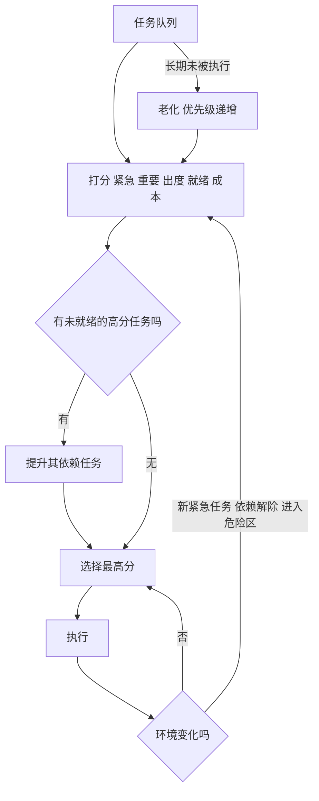

# 第 20 章：优先级排序（Prioritization）

- **难度**：★★☆ | **预估学时**：1.5 小时 | **前置**：ch11、ch16、任务调度与排序算法

## 学习目标

学完本章，你能：
1. 用五条标准（紧急性、重要性、依赖、资源可用性、成本收益）给任务打分并排序。
2. 说清"静态优先级"和"动态优先级"的差别，以及什么时候必须动态调整。
3. 指出优先级排序最常见的三个坑：饥饿、优先级通胀、依赖反转。

## 一句话核心

优先级排序回答的不是"哪个任务最好"，而是"资源有限时，下一个动手的应该是哪一个"——它是一个调度问题，不是一个评价问题。

## 零基础讲解

### 概念 1：五条评估标准（难度：基础）

书里给出五个维度，这是本章的核心工具：

| 标准 | 问的问题 | 量化方式 |
|---|---|---|
| 紧急性 | 有没有截止时间 | 距截止的剩余时间 |
| 重要性 | 对主目标影响多大 | 影响面 × 影响深度 |
| 依赖关系 | 是不是别人的前置 | 出度（有多少任务等它） |
| 资源可用性 | 现在能不能干 | 工具/权限/数据是否就绪 |
| 成本收益 | 花多少换多少 | 预期收益 / 预估成本 |

**一个容易漏的点**：依赖关系这一条会反转直觉。一个"不重要但被五个任务依赖"的小步骤，实际优先级很高，因为不干它，后面五件事都卡住。

**实例（带数字）**：四个任务

| 任务 | 紧急 | 重要 | 出度 | 就绪 | 成本 |
|---|---|---|---|---|---|
| A 修复登录故障 | 高 | 高 | 3 | 是 | 2h |
| B 更新营销文案 | 低 | 中 | 0 | 是 | 1h |
| C 数据库迁移脚本 | 中 | 高 | 2 | 否（等审批） | 4h |
| D 回复客户邮件 | 中 | 低 | 0 | 是 | 0.5h |

排序结论：A 第一（紧急+重要+出度高）；D 第二（成本极低，可快速清空）；C 在审批到位后插到 D 之前（重要+出度 2），但当前"未就绪"所以不能排前面；B 最后。这里的关键是**"就绪"是一票否决项**——没准备好的任务排在前面只会让队列堵住。

### 概念 2：静态优先级与动态优先级（难度：进阶）

**静态**：任务创建时定一次，之后不变。简单、可预测，适合流程稳定的场景。

**动态**：环境变化时重排。书里明确说这是该模式的关键特性——新关键事件出现、截止时间临近、资源状态变化，都要触发重排。

**什么时候必须动态**：
1. 新任务插入且其紧急性高于当前所有任务（线上故障）；
2. 某任务的依赖被解除（审批到位了）；
3. 某任务的截止时间进入危险区（剩余时间 < 预估耗时）。

**代价**：频繁重排会导致"什么都在做，什么都没做完"。所以要设重排频率上限（比如每 30 秒一次），而不是每来一条消息就重排。

### 概念 3：三个典型故障（难度：高难）

**（1）饥饿**。低优先级任务永远排不上。经典解法是**老化**：任务每等待一个周期，优先级 +1 档，直到它必然被处理。

**（2）优先级通胀**。所有人都说自己"紧急 ASAP"，于是 P0 塞满队列，等于没有优先级。解法是**配额**：P0 最多占并发槽位的 20%，超出的自动降为 P1 并记录原因。

**（3）依赖反转**。一个高优先级任务依赖一个低优先级任务，如果不把后者提上来，前者永远跑不动。解法是**传递提升**：当高优先级任务被阻塞时，把它依赖的任务临时提升到同档。

### 概念 4：分层的优先级（难度：进阶）

书里说优先级排序可以发生在三个层级：
1. **目标层**：先决定做哪几个大目标（战略）。
2. **计划层**：某个目标内部的子任务排序（战术）。
3. **行动层**：这一刻选哪个工具调用（执行）。

三层要用**不同的标准**。目标层看重战略价值，行动层看重延迟与成本。用同一套标准套三层，会出现"为了省 0.5 秒的 API 延迟而推翻整个项目优先级"这种荒谬决策。

## 图示

看图说明：图里有三个反馈：依赖提升、动态重排、老化。这三条边分别解决依赖反转、环境变化、饥饿。少了任何一条，调度器都会在长期运行中退化。

## 类比与实例

- **类比**：医院分诊（ESI 五级）。一级（濒危）立即处理，五级（非紧急）可以等，但等太久会被升级——这就是老化。
- **失效边界**：分诊标准由医学证据支撑、全国统一；智能体的优先级标准往往由业务方各自定义，容易通胀。所以必须有人守门（配额）。
- **实例**：云资源调度。高峰时段把资源优先给关键应用，批处理任务排到非高峰。这是"按时段重排"，而不是"按任务重排"——时段是外部约束，属于环境变化触发的动态调整。

## 常见误解

- **别以为优先级是一个数字**——实际上它是多维标准的加权结果，单数字会掩盖"为什么高"。
- **别以为高优先级任务应该永远插队**——实际上插队会导致低优先级任务 starving，必须有老化。
- **别以为 LLM 能凭语义判断优先级**——实际上"ASAP""很重要"这类措辞在模型眼里都差不多，真正的优先级要靠结构化字段与规则计算。书里的示例让模型把"紧急/ASAP/关键"映射为 P0，这只是入口处的粗分类，不能替代调度器。
- **别以为排好序就完事**——实际上执行过程中依赖会变、资源会变、截止会逼近，不做动态调整的队列很快就会失真。

## 自测题（答案）

1. （单选）一个任务本身重要性中等，但有 5 个高优先级任务依赖它。按本章标准，它应如何排序？
   - A. 排最后，因为自身重要性中等
   - B. 提前，因为出度高，是多个任务的前置
   - C. 直接丢弃
   - D. 等它自己变成紧急任务

   **答案**：B。**解析**：依赖关系（出度）是独立于重要性的一条标准，出度高意味着不干它会阻塞多个任务，实际优先级应提升。

2. （简答）什么是优先级饥饿？给出一种解法。
   **答案**：低优先级任务因为总有更高优先级的任务插入，长期得不到执行。解法是老化：任务每等待一个调度周期就提升一档优先级，保证最终被执行；也可设配额，为低优先级任务保留固定资源比例。**解析**：饥饿是调度算法的经典问题，不是业务问题。

3. （多选）下列哪些情况应当触发动态重排？
   - A. 出现紧急性高于当前所有任务的新任务
   - B. 某任务的依赖（审批）刚刚解除
   - C. 某任务剩余时间小于其预估耗时
   - D. 每收到一条用户消息就重排

   **答案**：A、B、C。**解析**：D 会导致调度抖动，重排应有频率上限。

4. （填空）优先级通胀的解法是设______，例如 P0 最多占用______的并发槽位。
   **答案**：配额；固定比例（如 20%）。**解析**：没有配额的 P0 等于没有优先级。

## 复习锚点

- 五标准：紧急、重要、依赖（出度）、就绪、成本收益。
- "就绪"是一票否决项。
- 三故障：饥饿（老化解）、通胀（配额解）、依赖反转（传递提升解）。
- 三个层级用不同标准，别混用。
