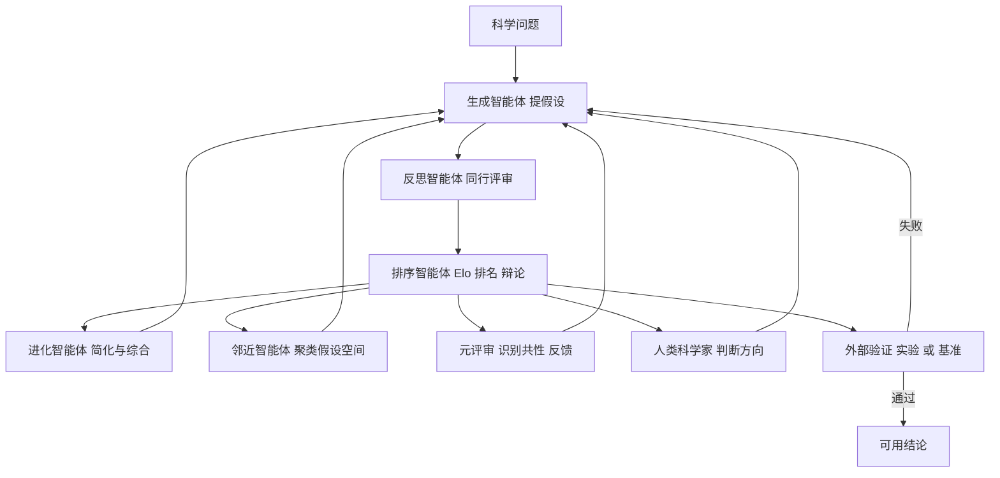

# 第 21 章：探索与发现（Exploration & Discovery）

- **难度**：★★★ | **预估学时**：2 小时 | **前置**：ch17 推理、ch07 多智能体、ch19 评估

## 学习目标

学完本章，你能：
1. 说清"探索"与"优化"的区别：一个在已定义的解空间里找最优，一个去发现解空间之外的东西。
2. 描述 AI 联合科学体的六个专职智能体各自负责什么。
3. 解释为什么这类系统必须有安全审查，以及"科学家在环"解决了什么。

## 一句话核心

探索不是"多试几次"，而是**在一个没有明确评分函数、甚至不知道答案长什么样的空间里，靠生成—辩论—进化把候选假设慢慢推向可用**。

## 零基础讲解

### 概念 1：探索 vs 优化（难度：基础）

- **优化**：目标明确、解空间已知，找最好的那个。比如"在给定约束下把配送路线缩短 10%"。
- **探索**：目标模糊、解空间未知，先找出"有哪些可能"。比如"这种材料有没有可能用于超导"。

**判据一句话**：如果你能写出评分函数，那是优化；如果你连"好答案长什么样"都说不清，那是探索。

**类比**：找矿。优化是在已知矿区里选最好的钻点；探索是先做地质勘探，判断哪里可能有矿。失效边界：勘探有物理规律可依，科学假设的"可能有价值"极难事先判断——所以这类系统必须靠辩论和评审来替代缺失的评分函数。

### 概念 2：AI 联合科学体（难度：进阶）

这是书里最完整的案例，六类专职智能体：

| 智能体 | 职责 |
|---|---|
| 生成（Generation） | 通过文献探索与模拟科学辩论，提出初步假设 |
| 反思（Reflection） | 作为同行评审，评估正确性、新颖性、质量 |
| 排序（Ranking） | 用 Elo 排名，通过模拟辩论比较与排序假设 |
| 进化（Evolution） | 持续优化高排名假设：简化概念、综合观点、探索非常规推理 |
| 邻近（Proximity） | 计算邻近图，聚类相似观点，辅助探索假设空间 |
| 元评审（Meta-review） | 综合所有评审与辩论结果，识别共性并反馈 |

**Elo 排名为什么合适**：假设质量没有绝对分数，只能两两比较。Elo 正是为"只能比较、不能绝对打分"的场景设计的。这和棋类评级同理。

**这套流程的结构**：生成 → 辩论 → 进化，循环往复。人类科学家输入问题，系统自己转。

**实测成绩**（书里给的）：
- GPQA 基准上，内部 Elo 评分与准确率高度一致；"钻石集"难题 top-1 准确率 78.4%；
- 15 个挑战性问题上的表现优于其他先进 AI 模型与人类专家的"最佳猜测"；
- 药物再利用：为急性髓性白血病提出 KIRA6，后续体外实验证实在多种 AML 细胞系中能抑制肿瘤活性；
- 肝纤维化：发现新表观遗传靶点，人源肝类器官实验验证有抗纤维化活性，其中一种药物已获 FDA 批准用于其他疾病，具备再利用潜力；
- 抗菌耐药：两天内独立复现了另一个团队十余年后才实验验证的发现（cf-PICIs 与噬菌体尾部相互作用扩展宿主范围）。

这组结果说明：**在有大量公开文献、且结论可被实验验证的领域，这套方法确实能产出可用的假设**。

### 概念 3：局限与安全（难度：进阶）

书里很诚实地列了三条局限：
1. **只依赖开放文献**，付费墙后的成果可能漏掉；
2. **对负面实验结果获取有限**——而负面结果对资深科学家判断方向极其重要（别人试过失败了，你不知道就会重试）；
3. **受限于底层 LLM**，可能事实错误或幻觉。

安全方面：所有研究目标与生成假设都做安全审查；1200 个对抗性目标的初步评估显示能有效拒绝危险输入；通过 Trusted Tester Program 逐步开放。

**"科学家在环"的意义**：系统强调增强而非替代。研究者用自然语言互动、反馈、引导探索方向。这不是客套话——探索类任务的价值判断高度依赖领域直觉，机器给不出"这个方向值得投入三年"的判断。

### 概念 4：Agent Laboratory（难度：进阶）

另一个案例，把科研流程拆成四阶段：
1. **文献综述**：自动从 arXiv 等库收集、分析、分类文献；
2. **实验**：设计、数据准备、执行、结果分析，可调 Python 执行与 Hugging Face 模型；
3. **报告撰写**：结合实验与综述，按学术规范生成，集成 LaTeX 排版与图表；
4. **知识共享**：AgentRxiv 平台，支持智能体成果的存储、检索与协作。

**角色分工模拟学术层级**：教授（定议程、分任务）→ 博士后（执行、写论文）→ 评审（同行评审）→ ML 工程（数据准备代码）→ 软件工程（指导 ML 工程）。

**三智能体评审机制**值得单独说：三个评审分别关注"是否带来研究洞见""是否对领域有影响""是否有前所未有的新观点"。这三条正好对应论文评审的三个常见维度，比让一个评审打一个总分更接近真实评审。

评分输出要求结构化：`Summary`、`Questions`、`Limitations`、`Ethical Concerns`、`Overall`（1-10）、`Decision`（只接受 Accept 或 Reject，不允许"弱接受""边界接受"这类模糊档）。

**为什么不允许模糊档**：因为模糊档会让下游统计失去意义，也让评审逃避做判断。这是个很实用的设计约束。

### 概念 5：探索类系统的三个前提（难度：高难）

从这两个案例能抽出三条可复用的前提：
1. **必须有外部验证手段**。AI 联合科学体的产出最终靠体外实验、类器官实验验证；Agent Laboratory 靠代码执行与基准。没有验证，探索就只是"生成看起来很厉害的文本"。
2. **必须有竞争与淘汰机制**。辩论、Elo 排名、锦标赛，都是为了把"看起来都不错"的候选排出高下。
3. **必须有人守方向**。方向错了，再多算力也只是更快地走错。

## 图示

看图说明：这是一个闭环系统，但外面有两条不可缺少的边——人类科学家与外部验证。把这两条去掉，剩下的就是一个自我循环的文本生成器，越转越像真的。

## 类比与实例

- **类比**：科研组会。有人提想法（生成）、有人挑刺（反思）、大家投票排序（Elo）、有人接着改进（进化）、导师把关方向（人类）。组会开得好的关键是"有人真敢说这个想法不行"。
- **失效边界**：组会成员有真实实验能力，能验证；纯 LLM 系统不能做实验，所以必须有外部验证接口，否则结论只是推测。
- **实例（带数字）**：假设生成 100 条，反思淘汰 60 条，Elo 排名选出前 10，进化产出 30 条改进版，最终 3 条进入实验验证，1 条有价值。这个漏斗比例（100 → 1）说明探索类系统的产出率天然很低，不能用"命中率"衡量它的价值，要看"是否有任何一条超越了已有方案"。

## 常见误解

- **别以为探索就是随机多试**——实际上它靠"生成—评审—排序—进化"的结构化循环，随机采样只是起点。
- **别以为 LLM 能独立做科学**——实际上它产出的是假设，验证必须靠实验或外部基准。
- **别以为辩论一定能提升质量**——实际上没有裁决机制（Elo、投票规则）的辩论会变成互相附和。
- **别以为这类系统可以无人值守**——实际上方向判断与安全审查都需要人，"科学家在环"是设计而非退让。

## 自测题（答案）

1. （单选）下列哪项最能区分"探索"与"优化"？
   - A. 探索需要更多算力
   - B. 探索的目标函数（评分函数）尚不明确，甚至解空间未知
   - C. 探索一定需要多个智能体
   - D. 优化只能用传统算法

   **答案**：B。**解析**：能否写出评分函数是关键判据；算力与智能体数量都不是本质区别。

2. （简答）AI 联合科学体为什么要用 Elo 排名而不是直接打分？
   **答案**：因为假设质量难以绝对打分，只能两两比较优劣；Elo 正是为"只能比较"的场景设计的评级机制，通过模拟辩论积累相对胜负关系，得到稳定排序，并且与后续实验准确率高度一致。**解析**：缺少绝对标准时，相对比较更可靠。

3. （多选）书里提到的 AI 联合科学体的局限包括？
   - A. 只依赖开放文献，可能漏掉付费墙后的成果
   - B. 对负面实验结果的获取有限
   - C. 受底层 LLM 限制，可能事实错误或幻觉
   - D. 完全无法生成新假设

   **答案**：A、B、C。**解析**：D 错，生成假设正是它的强项。

4. （填空）探索类系统的三个前提：外部验证手段、______、______。
   **答案**：竞争与淘汰机制；人类守方向。**解析**：缺任一条，系统会退化为自娱自乐的文本生成。

## 复习锚点

- 探索：解空间未知、评分函数缺失；优化：已知空间里找最优。
- 生成—辩论—进化是核心循环，Elo 解决"无绝对分"的排序问题。
- 探索的产出率天然低（100 → 1），价值看"是否超越已有方案"。
- 必须有外部验证与人在环，否则只是文本游戏。
