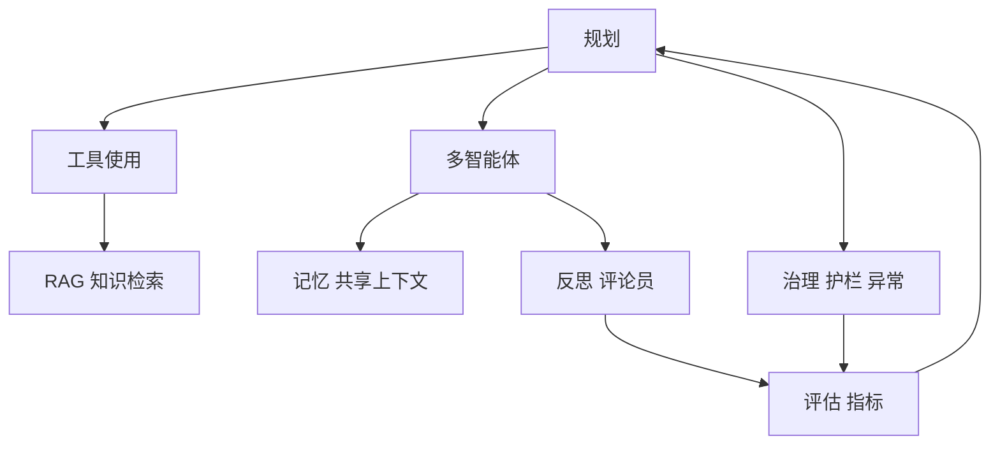

# 第 22 章：结论——把模式组合成系统

- **难度**：★★☆ | **预估学时**：1 小时 | **前置**：全部章节（建议学完主体再来）

## 学习目标

学完本章，你能：
1. 把 21 个模式归到四组能力里，并说清每组的分工。
2. 用一个具体案例说明五个以上模式如何串成一个系统。
3. 判断一个系统该不该继续加模式。

## 一句话核心

真正的能力不在"会用某个模式"，而在**知道哪些模式必须成组出现**——规划离不开工具，反思离不开判据，协作离不开记忆，治理离不开评估。

## 零基础讲解

### 概念 1：四组能力（难度：基础）

书里把 21 个模式归成四类，这个归类比按章罗列有用得多：

1. **核心执行与任务分解**：提示链（线性拆解）、路由（条件选择）、并行化（独立子任务同时做）、规划（从执行者升级为战略家）。
2. **与外部环境交互**：工具使用（调 API、数据库）、知识检索（RAG，把相关信息塞进上下文）。
3. **状态、学习与自我提升**：记忆管理（短期上下文 + 长期知识）、反思与自我纠错（批判自己的输出）、学习与适应（从反馈中进化）。
4. **协作与沟通**：多智能体协作（专职分工）、A2A（跨框架通信）。

这四组不是并列的，是有依赖的：**执行层是骨架，交互层是感官，状态层是记忆与判断，协作层是组织**。

### 概念 2：组合案例（难度：进阶）

书里给了一个完整例子：自主 AI 研究助手。至少融合五个模式：

1. **规划**：用户说"分析量子计算对网络安全的影响"，规划智能体拆成多步计划（识别基础概念 → 研究常见加密算法 → 查找专家对量子威胁的分析 → 综合成报告）。
2. **工具使用**：执行计划时大量调工具（搜索、学术数据库、金融数据 API）。
3. **多智能体协作**：研究员智能体执行搜索并收集信息，输出摘要与链接交给写手智能体，写手按计划纲要综合成草稿。
4. **反思**：第三个评论员智能体审查草稿，检查逻辑、事实、表达，反馈回写手，写手用自我纠错模式优化。
5. **记忆管理**：整个流程维护研究计划状态、收集的信息、草稿、反馈，保证多步多智能体上下文一致。

**这个例子的启示**：把五个模式去掉任何一个，系统都会明显退化——
- 去规划：跑偏、漏步；
- 去工具：只能说训练数据里的话；
- 去协作：一个上下文装不下所有角色；
- 去反思：草稿的错误无人拦；
- 去记忆：每一步都从零开始。

### 概念 3：什么时候该停止加模式（难度：高难）

书里没有明说，但可以从它的取舍逻辑推出来。三个停止信号：
1. **加了模式但没有对应的失败案例**。如果说不清"不加会出什么问题"，就是过度设计。
2. **加了模式但评估指标没变好**。第 19 章的评估就是用来做这个判断的。
3. **加了模式后故障面变大且不可观测**。多一个环节就多一个可能出错的地方，如果没有日志与追踪，等于用可靠性换复杂度。

**一个反向判据**：好的组合通常呈现"一个产出、一个检查、一个兜底"的三段结构。如果你的系统有五层审查却只有一个产出环节，那大概率是审查过剩、产出不足。

### 概念 4：作者对未来趋势的判断（难度：进阶）

书里最后给了几个方向，值得知道但不该当结论：
- **更强的自主性与推理**：从"人在环中"转向"人在环上"（ch13），智能体自主执行长周期任务，只在完成或关键异常时报告。
- **智能体生态与标准化**：开放平台与市场，开发者可部署、发现、编排智能体；A2A、MCP 这类原则成为行业标准。
- **安全、对齐、健壮性成为核心议题**：学习与适应不能偏离初衷，需要新的"安全模式"与测试验证规范。

**一个诚实的判断**：这三条都在发生，但速度不同。标准化（MCP、A2A）走得最快，自主长周期任务最慢——因为它的失败代价最高，而评估手段最不成熟。

## 图示

看图说明：这是全书模式的依赖图，不是流程顺序图。注意所有箭头最后都汇到"评估"——没有评估，其他模式改得对不对无从判断。也注意"治理"从规划处进来：护栏与异常处理应该贯穿全程，不是最后一步才加。

## 类比与实例

- **类比**：建房子。规划是图纸，工具是施工机械，记忆是材料仓库，协作是施工队，反思是监理，评估是验收，护栏是安全网。缺监理的房子能盖起来，但不敢住。
- **失效边界**：房子盖完就固定了，智能体要持续运行、持续调整，所以"验收"必须变成"持续监控"（ch19）。
- **实例**：把研究助手简化到 3 个模式（规划 + 工具 + 反思）也能跑，但输出质量波动大：没有协作，一个上下文里既要检索又要写作，风格与事实核查互相拉扯；没有记忆，多轮追问时上下文重建成本高。这说明"最小可用组合"和"高质量组合"是两套设计。

## 常见误解

- **别以为模式越多系统越强**——实际上每个模式都有成本，超过需求的模式只是增加故障面。
- **别以为组合就是把模式串起来**——实际上有效的组合依赖特定接口（共享状态、消息格式、判据来源），接口不对就串不起来。
- **别以为评估可以最后补**——实际上评估是判断"该不该加模式"的唯一依据，必须在过程中就在。
- **别以为未来趋势能直接指导今天的设计**——实际上"自主长周期任务"还很远，今天能落地的仍是带人在环与护栏的组合。

## 自测题（答案）

1. （多选）书里把 21 个模式归为哪几组能力？
   - A. 核心执行与任务分解
   - B. 与外部环境交互
   - C. 状态、学习与自我提升
   - D. 协作与沟通

   **答案**：A、B、C、D。**解析**：四组对应执行、交互、状态、协作。

2. （简答）研究助手案例中，如果去掉"记忆管理"，会出现什么问题？
   **答案**：多步多智能体流程无法保持一致：研究计划状态、已收集信息、草稿、评论反馈都要反复重建；多轮追问时上下文要重新拼，成本上升且容易丢失关键约束。**解析**：记忆是协作的粘合剂。

3. （单选）判断"该不该继续加模式"最可靠的依据是？
   - A. 竞品有没有用
   - B. 是否有对应的失败案例，且评估指标证明加之前确实更差
   - C. 模式是否足够新
   - D. 团队是否熟悉

   **答案**：B。**解析**：没有失败案例支撑的模式是过度设计；评估指标是唯一客观依据。

4. （填空）书里对未来的一条判断是：从"人在环中"转向"______"。
   **答案**：人在环上（Human-on-the-loop）。**解析**：人定规则，AI 实时执行，异常时介入。

## 复习锚点

- 四组能力：执行、交互、状态、协作；治理贯穿。
- 组合案例：规划 + 工具 + 协作 + 反思 + 记忆，缺一退化。
- 停止信号：无失败案例、指标无改善、故障面不可观测。
- 评估是所有模式的公共依赖。
