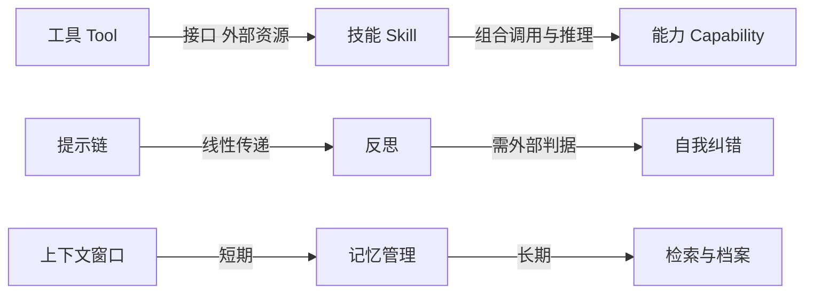

# 第 23 章：术语表与常见问题

- **难度**：★☆☆ | **预估学时**：1 小时（可当工具书查阅） | **前置**：无

## 学习目标

学完本章，你能：
1. 准确区分几组最常被混用的词：工具 vs 技能、提示链 vs 反思、上下文窗口 vs 长期记忆。
2. 用书里的术语表快速定位一个陌生概念。
3. 回答常见问题里那几个"看起来简单其实很关键"的问题。

## 一句话核心

这一章的价值不在背定义，而在**把被混用的词分开**——大部分设计错误源于用错了词，而不是用错了技术。

## 零基础讲解

### 概念 1：基础术语（难度：基础）

| 术语 | 书里的定义 | 一句话记法 |
|---|---|---|
| Prompt（提示词） | 用户向模型输入的问题、指令或陈述 | 你说的话 |
| Context Window（上下文窗口） | 模型一次能处理的最大 token 数，含输入与输出 | 它的短期工作台 |
| In-Context Learning | 靠提示里的示例学新任务，不需重训 | 看例子就会 |
| Few-shot / Zero-shot | 给少量或零个示例来引导 | 教几个 samples |
| Multimodality（多模态） | 能处理文本、图片、音频等多种数据 | 不止读字 |
| Grounding（事实锚定） | 把输出关联到可验证的真实信息源 | 有出处 |

**最该记的是 Grounding**：它是幻觉问题的解药，也是 RAG（第 14 章）存在的根本理由。判断一个系统有没有 grounding，就问一句"它说的这句话，能指到哪份材料"。

### 概念 2：模型架构与训练流程（难度：进阶）

- **Transformer**：现代 LLM 的基础架构，核心是自注意力，能捕捉长文本里词与词的关系。
- **MoE（专家混合）**：用"路由器"选少量专家子网络处理输入，参数规模巨大但计算成本可控。
- **扩散模型**：加噪再学去噪，擅长生成图像。
- **Mamba**：选择性状态空间模型，擅长超长序列，被视为 Transformer 的潜在替代。

训练流程三段：
1. **预训练**：海量通用文本上学语言、推理、世界知识。目标函数有 CLM（预测下一个词）、MLM（填补被遮住的词）、去噪、对比学习、NSP（判断两句是否衔接）。
2. **微调**：小规模专用数据上适配任务。主流是 SFT（有监督微调），变体有指令微调；省算力的方案是 PEFT，如 LoRA（只更新低秩参数）、QLoRA（再加量化）。
3. **对齐**：让行为符合人类价值观。主流是 RLHF（训奖励模型 + PPO），简化版是 DPO（跳过奖励模型）、KTO（简化数据收集）；部署前加护栏实时过滤。

**为什么智能体工程师要知道这些**：因为很多"模型不给力"的问题其实是训练阶段的问题（对齐不足、指令微调不够），不是提示能修的。知道边界在哪，才不会在提示上死磕。

### 概念 3：智能体能力术语（难度：进阶）

CoT（思维链）、ToT（思维树）、ReAct（推理+行动）、Planning（规划）、Deep Research（深度研究）、Critique Model（批评模型）——这六个在第 17 章都展开过，这里只强调一条：**它们都建立在"推理阶段多花算力"这个共同前提上**，区别只是花法不同（多写步骤 / 多分路径 / 多调工具 / 多轮批评）。

**Deep Research** 值得单独记：它不是"搜一次"，而是反复检索、综合、提出新问题，形成系统性理解。判据是"是否会因为新发现而修改原来的问题"。

### 概念 4：FAQ 里最关键的几组辨析（难度：进阶）

**（1）工具 vs 技能**
- 工具：外部资源，如天气 API、计算器。
- 技能：已学会的集成能力，往往结合工具调用与内部推理，如"订票"技能可能涉及日历 + 航空 API。

一句话：**工具是你能调的，技能是它会做的**。工具描述的是接口，技能描述的是能力。

**（2）简单提示链 vs 反思**
书里明确：简单提示链（A 的输出喂给 B）往往只是让模型重述前文，不会真正改进。真正的反思需要结构化批评——按标准分析、检查逻辑、核实事实。这正是第 4 章"反思必须有外部判据"的来源。

**（3）两种反思类型**
- "检查你的工作"：回顾自己的输出，抓简单错误（漏了什么）。
- "内部批评者"：独立批评者按特定标准评估工作者的输出（以为对其实错）。

**（4）反思能否多次应用**
可以，但要设上限。书里说迭代能改进，实际工程必须加 `max_rounds`（第 4 章给了 2~3 轮的经验值），否则会陷入过度修正或空转。

**（5）为什么规划重要**
LLM 在多步或有依赖的任务中容易丢目标、漏步骤、搞错输入输出。计划提供路线图，让需求按逻辑顺序完成。书里还提到一个实践：**先给用户看计划并征求批准**，这既是透明度，也是第 13 章的 HITL。

## 图示

看图说明：三组关系分别是"接口→能力""传递→判断""短期→长期"。每一组里右边那个都不是左边的升级版，而是解决了左边解决不了的另一类问题。

## 类比与实例

- **类比**：术语表像工具间墙上的标签。锤子、扳手、螺丝刀长得像，标签贴错就会拿错工具，活干不成还怪工具不好。
- **失效边界**：标签只写名称，不写"什么时候不该用"。所以每章末尾的"常见误解"比术语表更重要。
- **实例**：一个团队争论"要不要加反思"，其实一方说的是"多重试一次"（提示链重复），另一方说的是"加独立评审 + 测试判据"（真反思）。把词分清，争论就结束了。

## 常见误解

- **别以为 few-shot 就是微调**——实际上 few-shot 是在提示里给例子，权重不变；微调是改权重。
- **别以为上下文窗口大就等于记忆好**——实际上窗口有限、会话结束即失、每轮重复计费（第 8 章）。
- **别以为 critique model 是独立产品**——实际上它可以就是一个专用提示或一个评审智能体。
- **别以为术语表能替代章节**——实际上定义只给边界，不给判据；判据在每章的"失效边界"里。

## 自测题（答案）

1. （单选）"订票"这件事，按书里的定义属于？
   - A. 工具
   - B. 技能
   - C. 模型架构
   - D. 训练目标

   **答案**：B。**解析**：技能是结合多个工具调用与内部推理形成的集成能力；工具是其中的单个外部资源（日历 API、航空 API）。

2. （简答）为什么"简单提示链"常常得不到高质量输出？
   **答案**：因为把 A 的输出直接喂给 B 时，模型往往只是重述或换措辞，没有真正按标准检查。要提升质量，必须让后一步做结构化批评（对照标准、核实事实、检查逻辑），并有外部判据支撑。**解析**：形式上是链，实质上是同义改写。

3. （多选）下列哪些属于"对齐"阶段的技术？
   - A. RLHF（奖励模型 + PPO）
   - B. DPO
   - C. LoRA
   - D. 护栏

   **答案**：A、B、D。**解析**：LoRA 属于参数高效微调（PEFT），在微调阶段，不是对齐阶段。

4. （填空）Grounding（事实锚定）的作用是把输出关联到______，从而减少______。
   **答案**：可验证的真实信息源；幻觉。**解析**：RAG 是常用的 grounding 手段。

## 复习锚点

- 工具是接口，技能是能力。
- 提示链是传递，反思是判断（需外部判据）。
- 上下文窗口 ≠ 长期记忆。
- 训练三段：预训练、微调、对齐；护栏在部署侧。
