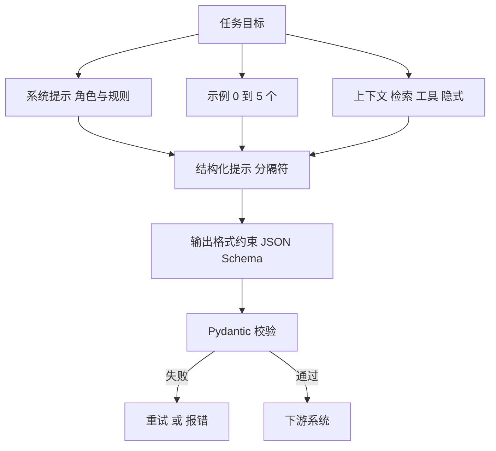

# 第 24 章：附录 A——高级提示工程技术

- **难度**：★★☆ | **预估学时**：2 小时 | **前置**：ch01 提示链、ch28 上下文工程（即 ch05 相关章节）

## 学习目标

学完本章，你能：
1. 用五条核心原则检查一份提示，指出哪里含糊。
2. 判断一个任务该用零样本、单样本还是少样本，以及示例怎么选。
3. 写出一个带系统提示、角色、分隔符、结构化输出的完整提示模板。

## 一句话核心

提示工程不是"写得更长更礼貌"，而是**把模糊的期待翻译成可判定的约束**：任务是什么、输入在哪、输出长什么样、什么算不合格。

## 零基础讲解

### 概念 1：五条核心原则（难度：基础）

书里给的这五条，每条都能落到具体改法：

| 原则 | 具体做法 | 反例 → 改法 |
|---|---|---|
| 清晰与具体 | 明确任务、输出格式、限制条件 | "写点关于气候的东西" → "写 300 字，面向高中生，说明温室效应的三个成因" |
| 简洁 | 去掉冗余句与复杂修饰 | "能否麻烦你帮我稍微总结一下这个……" → "总结下文，100 字以内" |
| 用动作动词 | Act、Analyze、Extract、Summarize | "这个文本你可以看看" → "从下文提取人名与金额" |
| 正面指令优于约束 | 说"要什么"，少说"别做什么" | "不要写废话" → "每句都包含一个事实或结论" |
| 实验与迭代 | 记录每次改动与结果 | 凭感觉改 → 维护一个提示版本表 |

**关于"正面指令"要补一句**：约束在安全与格式场景仍然必要（"不要输出 Markdown"），但过度依赖会让模型注意力集中在"避开雷区"，反而降低输出质量。正确做法是"给出目标 + 少量必要禁令"。

### 概念 2：零/单/少样本（难度：进阶）

| 方式 | 给几个例子 | 什么时候用 |
|---|---|---|
| 零样本 | 0 | 任务常见（翻译、摘要、简单问答） |
| 单样本 | 1 | 输出格式特殊，需要示范一次 |
| 少样本 | 3~5 | 需要特定风格、分类口径、结构化抽取 |

**示例选择的四条经验**（书里都提到了）：
1. **准确**：错误示例会直接把模型带偏，比不给示例更糟；
2. **有代表性**：覆盖典型情况，不能只挑简单样例；
3. **有边界覆盖**：把"看起来像 A 其实是 B"的难例放进去；
4. **顺序要打散**：分类任务里如果示例全是同一类连续排列，模型会过拟合这个顺序。

**"多样本"的趋势**：现代模型上下文变长，可以在提示里放十几甚至几十个示例，效果比 3~5 个更好。代价是 token 成本（第 16 章）。

### 概念 3：提示结构化（难度：进阶）

一份结构化提示通常有四块，用分隔符隔开：

```
[系统提示] 你是一名严谨的技术编辑，只输出事实，不猜测。
[角色] 你现在扮演一位给初中生讲科学的老师。
[上下文] 以下是待处理的原文：
"""
（原文）
"""
[指令] 把原文改写成 3 段，每段不超过 80 字，保留全部数字。
[输出格式] 返回 JSON：{"paragraphs": ["...", "...", "..."]}
```

**分隔符为什么重要**：模型分不清"哪段是指令、哪段是待处理数据"时，会把数据里的内容当指令执行（这就是提示注入的入口）。三重反引号、XML 标签、`---` 都是常用分隔符，选一种并保持一致。

**角色提示的作用与边界**：`Act as a travel guide` 能让输出更贴合该领域的语气与知识分布。但它不会让模型获得它没有的知识——角色提示改的是"风格与取舍"，不是"事实储备"。

### 概念 4：上下文工程（难度：高难）

书里把上下文工程和静态系统提示区分开：**上下文工程是动态地为当前任务组装背景信息**。

它的层次：
1. **系统提示**：基础指令与角色（相对静态）；
2. **外部数据**：检索文档（RAG）、工具输出（API 结果）；
3. **隐式数据**：用户身份、交互历史、环境状态。

**核心判断**（书里原话的意思）：输出质量更多依赖于上下文的丰富度与相关性，而不是模型架构。

**一个具体例子**：讨论日本旅行时，用户说"推荐东京适合家庭的三项活动"。"家庭"这个词的含义要靠上下文确定——如果历史对话里提到"带 6 岁孩子"，就该推荐亲子友好的；如果提到"带老人"，推荐方向完全不同。这个信息不在提示词里，在上下文里。

**隐私边界**：隐式数据（身份、位置、健康信息）进入上下文前必须做治理，企业、医疗、金融场景尤其严格。

### 概念 5：结构化输出与 Pydantic 校验（难度：进阶）

要求模型输出 JSON 只是第一步，**必须校验**。书里给了 Pydantic 的做法：

```python
from pydantic import BaseModel

class User(BaseModel):
    name: str
    age: int
    interests: list[str]

# LLM 返回的字符串
raw = '{"name": "李明", "age": 22, "interests": ["自然语言处理", "Python"]}'
user = User.model_validate_json(raw)   # 解析 + 类型校验一步完成
```

**为什么必须校验**：模型会漏字段、给错类型（年龄写成 `"22岁"`）、加多余字段。不校验就直接进下游，会在很远的地方炸掉——这是第 18 章"结构性护栏"的具体形态。

**请求 JSON 的附带好处**：书里提到，要求 JSON 有助于限制幻觉，因为自由文本里更容易"顺手编"。结构化字段逼着模型把每个值落实。

## 图示



看图说明：关键在 G 这个节点——它把"模型说的话"变成"程序能信的数据"。跳过这一步，提示工程做得再好也只是"看起来规范"。

## 类比与实例

- **类比**：给外包写需求文档。写"做个好看的页面"必然返工；写"三栏布局、主色 #2563eb、移动端 375px 优先、交付 HTML"才能验收。
- **失效边界**：外包能问澄清问题，模型不会——它只会按自己的理解填空白。所以提示里的空白必须自己填。
- **实例（带数字）**：抽取任务。提示 A："从简历里提取信息。" → 10 份测试，6 份格式不一，需人工整理。提示 B：给 JSON schema + 3 个示例（含一个"没有工作经历"的边界例）+ Pydantic 校验 + 失败重试一次 → 10 份全部通过，0 份需人工。差距不在模型，在提示的约束密度。

## 常见误解

- **别以为提示越长越好**——实际上冗长会稀释关键指令，模型对长提示中段的注意力最弱。
- **别以为角色提示能给模型新知识**——实际上它改的是风格与取舍偏好，不是事实储备。
- **别以为要求 JSON 就一定有 JSON**——实际上必须加校验与重试，模型会加解释、加注释、漏字段。
- **别以为提示工程能被上下文工程替代**——实际上两者是不同层：前者管"怎么说"，后者管"给它看什么"。

## 自测题（答案）

1. （单选）分类任务中，5 个示例全是同一类别连续排列，最可能导致什么问题？
   - A. token 超限
   - B. 模型过拟合示例顺序，倾向输出该类别
   - C. 模型拒绝回答
   - D. 输出格式错误

   **答案**：B。**解析**：书里明确建议分类任务混合不同类别示例顺序。

2. （简答）为什么"正面指令优于约束"？什么时候约束仍然必要？
   **答案**：正面指令明确告诉模型要做什么，注意力集中在目标上；过多禁令会让模型聚焦于规避风险，输出变得保守或空洞。约束在安全（禁止生成有害内容）与格式（禁止输出 Markdown）场景仍然必要，但应少量且明确。**解析**：目标清楚 + 少量必要禁令是最佳组合。

3. （多选）上下文工程包含哪些层次？
   - A. 系统提示
   - B. 检索文档
   - C. 工具输出
   - D. 隐式数据（身份、历史、环境）

   **答案**：A、B、C、D。**解析**：四层都在书里列出；隐式数据要注意隐私治理。

4. （填空）用 Pydantic 校验 LLM 输出时，解析与校验一步完成的方法是______。
   **答案**：`model_validate_json`。**解析**：它同时完成 JSON 解析与类型校验。

## 复习锚点

- 五原则：清晰、简洁、动作动词、正面指令、迭代。
- 示例四要求：准确、有代表性、覆盖边界、顺序打散。
- 结构化提示四块：系统、角色、上下文、指令 + 输出格式。
- 结构化输出必须校验（Pydantic）。
