# 第 25 章：附录 B–G——落地、框架与环境

- **难度**：★★☆ | **预估学时**：1.5 小时（可当索引查阅） | **前置**：ch05 工具使用、ch07 多智能体

## 学习目标

学完本章，你能：
1. 说清 ACI（智能体-计算机接口）的四步流程，以及它为什么绕开了 API。
2. 对比 LangChain、LangGraph、CrewAI、ADK 四种框架的定位与适用边界。
3. 判断一个任务该走 API、走 GUI 自动化，还是走人工。

## 一句话核心

这一组附录讲的是"智能体怎么真正碰到世界"：要么通过 GUI 像人一样点，要么通过 API 直接调，要么通过框架把流程编排起来——三种方式各有明确的代价与适用边界。

## 零基础讲解

### 概念 1：ACI 与 GUI 自动化（难度：进阶）

**ACI（Agent-Computer Interface）**：让 AI 直接与图形界面交互，像人一样识别屏幕上的图标、按钮。

四步流程：
1. **视觉感知**：截屏；
2. **GUI 元素识别**：把屏幕当结构化布局，区分可点击按钮、静态图片、可编辑文本框、标签；
3. **上下文理解**：ACI 模块作为视觉与 LLM 之间的桥梁，结合任务语境解释元素（放大镜 = 搜索，一组单选按钮 = 选项）；
4. **动态操作与反馈**：程序控制鼠标键盘，点击、输入、滚动、拖拽，并实时监控屏幕变化（加载、弹窗、报错）。

**为什么值得做**：很多系统没有 API，或者 API 权限拿不到。GUI 是"视觉前门"，绕开了 API 依赖。

**书里列的代表**：ChatGPT Operator（桌面应用自动化）、Google Project Mariner（Chrome 内网页任务）、Anthropic Computer Use（跨应用工作流）、Browser Use（开源，可访问 DOM）。

**代价（必须写清）**：慢（每步要截屏 + 推理）、脆（界面改版就失效）、贵（视觉 token 消耗大）、难验证（成功与否要靠再看屏幕）。所以判据是：**有稳定 API 就走 API，没有才走 GUI**。

### 概念 2：从屏幕到物理环境（难度：进阶）

- **Project Astra**：融合视觉、听觉、语音，通过摄像头与麦克风"看见""听见"环境，实时协助（找物品、调试代码）。
- **Gemini Live**：语音对话，可打断、可切换话题，支持摄像头输入与屏幕共享，识别语气、过滤背景噪音。
- **GPT-4o**：全模态，语音、视觉、文本间推理，接近实时对话；配套"实时 API"。
- **ChatGPT 智能体**：可自主浏览、动态生成并执行代码、与第三方软件集成。书里特别提到它发布"系统卡"，明确在线操作风险，并加入敏感操作需用户授权、内容过滤等防护。
- **Seeing AI**（微软）：为盲人和低视力用户实时讲解环境，文档朗读、货币识别、条码扫描、场景与颜色描述。
- **Claude 4 系列**：强推理 + 视觉，适合复杂多步分析与文档理解。

**一条共同线索**：所有这些系统都在把"多模态输入"变成"可行动的理解"。而它们的风险点也一致——**感知错了，后面全错**，且用户往往看不出来。

### 概念 3：Vibe Coding（难度：基础）

**白话定义**：开发者给高层目标或"感觉"（"做个简洁现代的落地页""让这个函数更 Pythonic"），AI 生成代码，再用自然语言反复调整。

四个特点：对话式提示、迭代优化、创意协作、关注"做什么"而非"怎么做"，外加一个"记忆库"（保存编码风格、项目约束，避免每次重复说明）。

**书里的判断**：软件工程的本质在变，重心从"记语法和 API"转向"创意与高层思考"。

**一个诚实的补充**：这条对"能判断代码好坏"的人成立，对不能判断的人不成立——你不知道它错在哪，就只能接受它给的东西。所以 vibe coding 的前提是"你有验收能力"。

### 概念 4：四框架速览（难度：进阶）

| 框架 | 核心抽象 | 强在哪 | 边界 |
|---|---|---|---|
| LangChain | LCEL 管道，组件串成链 | 线性 DAG 流程：简单 RAG、摘要、抽取 | 不支持循环 |
| LangGraph | 图结构，节点为函数或链，边为条件 | 支持循环与显式状态，适合多智能体、重试、工具调用 | 学习曲线陡 |
| CrewAI | 角色 + 任务 + Crew | 多智能体分工与顺序执行，快速搭团队 | 复杂控制流表达力有限 |
| ADK | Agent + 编排构件（Sequential/Parallel/Loop）+ 工具集 | 层级、并行、循环编排，评估与部署配套 | 生态相对新 |

**选择判据**：
- 流程单向、无循环 → LangChain（LCEL）；
- 需要循环、重试、状态机 → LangGraph；
- 角色分工明确、想快速验证多智能体 → CrewAI；
- 需要层级编排 + 内置评估 + 部署 → ADK。

**别被框架绑架**：书里跨框架给例子，正是说明模式本身与框架无关。学会模式，换框架只是换语法。

## 图示

```mermaid
flowchart TD
  T[任务] --> Q1{有稳定 API 吗}
  Q1 -->|有| API[直接调 API 或 MCP]
  Q1 -->|没有| Q2{界面会频繁变吗}
  Q2 -->|不常变 且 低频| GUI[GUI 自动化 ACI]
  Q2 -->|频繁变 或 高风险| H[人工 或 半自动]
  API --> W[框架编排]
  GUI --> W
  W --> Q3{需要循环与状态吗}
  Q3 -->|不需要| LC[LangChain LCEL]
  Q3 -->|需要| LG[LangGraph 或 ADK]
```

看图说明：这是一张"先选接口、再选框架"的决策图。顺序不能反——先定框架再找接口，通常会被框架的能力边界限制住。

## 类比与实例

- **类比**：寄快递。有 API 就像网上下单，快且可追踪；没 API 就像让机器人去快递点排队填单，能办成但慢且易出错。
- **失效边界**：快递点流程稳定，软件界面常改版；GUI 自动化的维护成本远高于 API。
- **实例（带数字）**：某内部系统只提供网页界面。用 GUI 自动化每月抓 200 份报表：每份约 40 秒（截屏与推理开销），总计约 2.2 小时；失败率约 8%，需人工补 16 份。若推动 IT 开放只读 API，单份约 0.5 秒，失败率降到 1% 以下。短期 GUI 能上线，长期 API 才是解。

## 常见误解

- **别以为 GUI 自动化能替代 API**——实际上它慢、脆、贵，只在没有 API 时才是合理选择。
- **别以为多模态感知一定比文本可靠**——实际上视觉识别会错，且错误很难被下游发现。
- **别以为 vibe coding 谁都能用**——实际上它要求使用者具备验收能力，否则只是把风险前移。
- **别以为框架选得越"高级"越好**——实际上线性流程用 LangGraph 是自找麻烦，简单任务用 CrewAI 反而绕。

## 自测题（答案）

1. （单选）ACI 的四步流程正确顺序是？
   - A. 截屏 → 元素识别 → 上下文理解 → 动态操作与反馈
   - B. 元素识别 → 截屏 → 操作 → 理解
   - C. 操作 → 截屏 → 识别 → 理解
   - D. 理解 → 截屏 → 操作 → 识别

   **答案**：A。**解析**：先看见，再分辨，再理解，最后动手并观察反馈。

2. （简答）什么情况下应该放弃 GUI 自动化，改用 API 或人工？
   **答案**：当界面频繁改版（维护成本高）、任务高频（每次几十秒的截屏推理开销累积惊人）、或操作不可撤回且风险高（如付款、删除）时，应改走 API；若 API 不可得且风险高，应保留人工。GUI 自动化适合"没有 API、界面稳定、低频、可回滚"的场景。**解析**：按"稳不稳、频不频、撤不撤"三条判断。

3. （多选）下列哪些属于书里提到的 GUI 交互智能体？
   - A. ChatGPT Operator
   - B. Google Project Mariner
   - C. Anthropic Computer Use
   - D. Seeing AI

   **答案**：A、B、C。**解析**：Seeing AI 是面向视障用户的环境描述应用，不是 GUI 操作智能体。

4. （填空）LangChain 的 LCEL 适合______流程，LangGraph 的关键优势是支持______。
   **答案**：线性 DAG（单向无循环）；循环与显式状态管理。**解析**：见框架对照表。

## 复习锚点

- ACI 四步：截屏、识别、理解、操作与反馈。
- 有 API 用 API，没 API 才 GUI；GUI 慢、脆、贵。
- 四框架：LangChain（线性）、LangGraph（循环+状态）、CrewAI（角色团队）、ADK（编排+评估）。
- vibe coding 的前提是使用者能验收。
