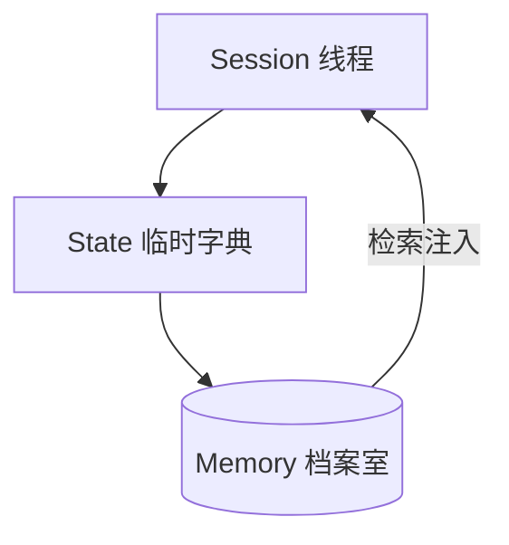

# 上下文窗口与记忆

- **难度**：★★☆ | **涉及章节**：第 8、1、14、16 章

## 一句话定义

上下文窗口是模型一次能看到的 token 上限（短期、易失、每轮计费）；记忆是跨会话保存并可检索的外部存储（长期、可持久、按需注入）。

## 为什么重要

把两者混为一谈会导致两种错误设计：以为窗口大就不用记忆（会话一断全丢），以为记忆就是把历史全塞回去（成本爆炸且稀释注意力）。

## 图示

## 详解

三层模型：
- **Session**：一次对话线程；
- **State**：会话内的临时字典，键前缀决定作用域（`user:` 跨会话、`app:` 全局、`temp:` 仅本轮）；
- **Memory**：长期档案，分语义（事实）、情景（经历）、程序性（规则）。

**压缩实例**：40 轮对话、每轮约 300 token ≈ 12,000 token;摘要压缩后约 2,500 token,保留决策与约束，丢弃寒暄与重复。

**反模式**：直接修改 session.state 会绕过事件处理，导致不记录、不持久化、并发冲突、元数据不更新。

## 常见误解

- 别以为窗口大就能当记忆——实际上会话结束即失，且每轮重复计费。
- 别以为记忆越多越好——实际上无关记忆会稀释注意力，检索质量比容量更重要。

## 在书中出现的脉络

| 章节 | 语境 | 关键结论 |
|---|---|---|
| 第 8 章 | 记忆管理 | 短期三个限制：容量、易失、计费 |
| 第 14 章 | RAG | 长期记忆的检索与 RAG 同源 |
| 第 16 章 | 资源优化 | 上下文剪枝同时省钱与提质 |

## 相关概念

- 前置：上下文窗口
- 后续：RAG、多智能体共享状态
