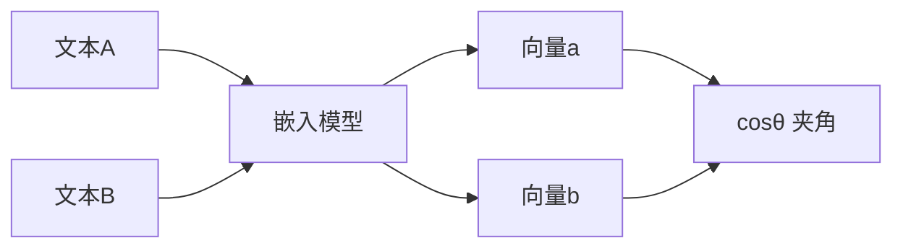

# 嵌入与余弦相似度

- **难度**：★★★ | **涉及章节**：第 14、8、19 章

## 一句话定义

嵌入是把文本映射成高维向量；余弦相似度是比较两个向量"方向是否一致"的度量，公式为 cosθ = (a·b)/(‖a‖‖b‖),只与夹角有关，与向量长度无关。

## 为什么重要

RAG 的召回、长期记忆的检索、语义评估、聚类，全都建立在"语义近 ⇒ 向量方向近"这个假设上。这个假设不是自然规律，是嵌入模型训练出来的——换一个嵌入模型，等于换一套几何。

## 图示

## 详解

**手算例**（三维）：q=(1,2,2), d1=(2,4,4)。
- 内积 = 1×2+2×4+2×4 = 18
- ‖q‖ = √(1+4+4) = 3
- ‖d1‖ = √(4+16+16) = 6
- cosθ = 18/(3×6) = 1 → 完全同向

注意 d1 是 q 的两倍长，欧氏距离是 3（并不近），但余弦是 1。这说明**余弦对长度不敏感**——在文本检索里这是优点（长文档与短查询可以比较），在需要长度信息的场景是缺点。

**工程要点**：
1. 高维下"方向近"的意义靠训练保证，不是数学必然；
2. 必须设相似度阈值（如 0.7），只按 top_k 取前 5 会把无关内容硬塞进上下文；
3. 混合检索（BM25 + 向量）是常态，纯向量对专有名词、编号不敏感。

## 常见误解

- 别以为余弦相似度高就等于语义相同——实际上同领域文本普遍相似度偏高，阈值要按语料校准。
- 别以为换嵌入模型只是换个库——实际上索引要重建，历史阈值全部失效。

## 在书中出现的脉络

| 章节 | 语境 | 关键结论 |
|---|---|---|
| 第 14 章 | RAG | 检索质量决定生成质量的上限 |
| 第 8 章 | 记忆 | 长期记忆靠向量检索召回 |
| 第 19 章 | 评估 | 语义相似度是自动化指标之一 |

## 相关概念

- 前置：向量、内积
- 后续：RAG、记忆管理
