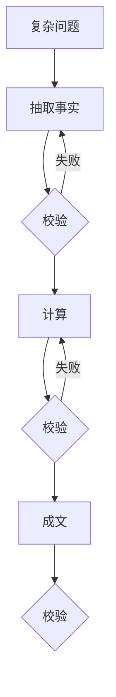

# 错误局部化

- **难度**：★★☆ | **涉及章节**：第 1、4、12、19 章

## 一句话定义

把一次"整体判断"拆成若干"局部转换",让错误只能在某一步产生、并在那一步被发现，而不是等到最终结果才发现"哪里都可能是错的"。

## 为什么重要

模型输出是不可验证的整体：一段 500 字的答案错了，你无法判断是知识缺失、推理跳步还是表达失误。拆成步骤后，每一步都有明确的输入与期望输出，错误可以被定位、被重跑、被修复。

## 图示

## 详解

三个可操作的拆法：
1. **按数据流拆**：抽取 → 变换 → 校验 → 呈现；
2. **按判据拆**：事实、逻辑、格式、语气分别检查（第 4 章的批评者按标准评审）；
3. **按责任人拆**：生成者与检查者分离（第 7 章批评-审查者）。

**代价**：拆得越细，token 与延迟越高，且步骤间需要契约（见"输出契约"）。拆到"每步只做一件事"通常是过度。

## 常见误解

- 别以为拆步骤就是多问几次——实际上关键在"每步可验证",不是"次数多"。
- 别以为拆得越细越好——实际上拆到不可验证的粒度（比如"判断这句话是否得体"）没有收益。

## 在书中出现的脉络

| 章节 | 语境 | 关键结论 |
|---|---|---|
| 第 1 章 | 提示链 | 判据：这一步的输出能否被独立验证 |
| 第 12 章 | 异常处理 | 检测要放在每一步，而不是最后 |
| 第 19 章 | 评估 | 轨迹评估就是错误局部化的度量 |

## 相关概念

- 前置：输出契约
- 后续：反思、轨迹评估
