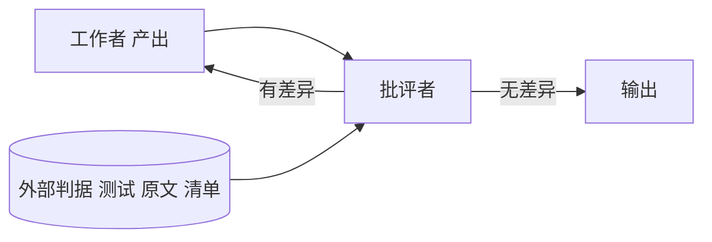

# 外部判据

- **难度**：★★★ | **涉及章节**：第 4、11、19、21 章

## 一句话定义

判断"这一步做对了没有"的依据，必须来自产出者之外：测试、原文、清单、规则、外部数据——不能是模型自己的"我觉得没问题"。

## 为什么重要

第 4 章的核心结论：反思有效的前提是有外部判据。没有判据的反思有三种退化：过度修正（越改越偏）、批评空转（说了一堆没改）、上下文溢出（反复重写把关键信息挤掉）。

## 图示

## 详解

四类常见判据：
1. **可执行判据**：单元测试、编译、schema 校验（最硬）；
2. **可比对判据**：与原文/知识库逐条核对（RAG 场景）；
3. **清单判据**：政策条款、检查表、验收标准；
4. **统计判据**：多次采样的一致性、历史基线偏离。

**实例**：代码生成智能体。让它"反思一下这段代码"往往只是加注释；让它"运行测试并修复失败用例",错误会被真实暴露。同一模型，效果差一个数量级。

## 常见误解

- 别以为模型自评就是反思——实际上那是"自我感觉",不是判据。
- 别以为判据越严越好——实际上过严会导致过度修正，把对的改错。

## 在书中出现的脉络

| 章节 | 语境 | 关键结论 |
|---|---|---|
| 第 4 章 | 反思 | 生产者 + 批评者 + 外部判据，三者缺一不可 |
| 第 11 章 | 目标监控 | 判据由执行者之外的角色持有 |
| 第 19 章 | 评估 | LLM 评审也需要外部锚点防自我偏好 |
| 第 21 章 | 探索 | 假设必须靠实验验证 |

## 相关概念

- 前置：错误局部化
- 后续：评估、护栏
