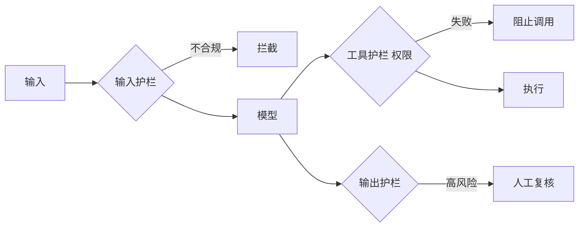

# 护栏分层

- **难度**：★★★ | **涉及章节**：第 18、13、12 章

## 一句话定义

在数据流的关键位置设置若干道必须通过的关卡（输入、提示约束、工具、外部审核、输出、人工），每道关卡有独立判据与明确的失败动作。

## 为什么重要

单层护栏必然被绕过（提示注入、编码变形、多轮稀释）或误伤（判据过严）。分层的作用是交叉覆盖：输入挡明显违规，工具层挡越权，输出层挡模型自己生成的有害内容。

## 图示

## 详解

关键设计点：
1. **默认动作**要按场景选：误伤成本高 → 疑罪从无；漏放成本高 → 疑罪从有。
2. **工具层是唯一能挡住"做错事"的一层**：参数里的身份、金额、ID 必须由框架从可信来源取，不能信模型。
3. **结构性护栏**（Pydantic 校验）挡的是"格式崩了导致下游炸",不是内容合规。
4. 关键判据优先用规则、白名单、分类器，别让另一个 LLM 自由裁量（它也会被注入）。

## 常见误解

- 别以为写了"请勿生成有害内容"就是护栏——实际上那只是提示层约束。
- 别以为护栏只在输入端——实际上工具层与输出层才是关键。

## 在书中出现的脉络

| 章节 | 语境 | 关键结论 |
|---|---|---|
| 第 18 章 | 护栏 | 六阶段；轻量模型做快速防线 |
| 第 13 章 | HITL | 高风险输出转人工 |
| 第 12 章 | 异常 | 降级链与升级 |

## 相关概念

- 前置：人类参与边界
- 后续：评估与监控
