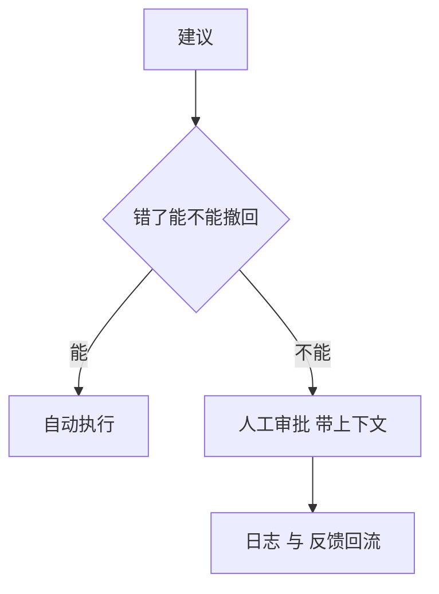

# 人类参与边界

- **难度**：★★☆ | **涉及章节**：第 13、12、18 章

## 一句话定义

在系统里明确划出"机器可以决定"与"必须由人决定"的分界，并把跨越分界的那一步设计成可阻断的操作。

## 为什么重要

不划边界的系统有两种结局：什么都问人（不可扩展），什么都不问（不可撤回的事故）。边界要写下来，不能靠"看情况"。

## 图示

## 详解

四个必须插人的节点：计划审批、工具使用确认、歧义解决、最终输出审核。统一判据是"**错了能不能撤回**"。

变体：**Human-on-the-loop**——人定规则，AI 实时执行，异常时介入。适合高频、单次价值低、规则可写清的场景（量化交易、呼叫中心分流）。

**代价**：可扩展性受限、依赖操作员专业水平、隐私需匿名化。

## 常见误解

- 别以为加个"确认"按钮就是 HITL——实际上不带上下文的确认，人只能盲点。
- 别以为人越多越安全——实际上审批点过多会导致疲劳与盲批。

## 在书中出现的脉络

| 章节 | 语境 | 关键结论 |
|---|---|---|
| 第 13 章 | HITL | 六方面：监督、干预、反馈、增强、协作、升级 |
| 第 12 章 | 异常 | 升级策略的终点是人 |
| 第 18 章 | 护栏 | 高风险输出转人工复核 |

## 相关概念

- 前置：幂等、风险分级
- 后续：护栏、评估
