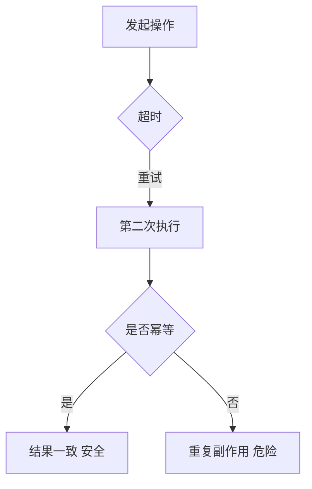

# 幂等

- **难度**：★★☆ | **涉及章节**：第 12、5、18 章

## 一句话定义

同一个操作执行一次和执行多次，结果相同。对智能体来说，这是"重试安全"的前提。

## 为什么重要

智能体最常见的故障是"超时后重试"。如果操作不幂等，重试就变成重复副作用：重复发邮件、重复扣款、重复创建工单。这不是理论风险，是线上最常见的资损来源之一。

## 图示

## 详解

三种实现幂等的方式：
1. **幂等键**：请求带唯一 id，服务端记录已处理的 id，重复请求直接返回上次结果；
2. **状态前置检查**：执行前查"这件事是不是已经做了"（查订单状态再发货）；
3. **设计成可覆盖**：用"设置成 X"替代"增加 X"（set balance 而不是 add balance）。

**智能体侧的要求**：工具定义里必须说明是否幂等；框架必须支持"重试前先查状态";不可幂等的操作（发送、付款、删除）必须走人类确认（第 13 章）。

## 常见误解

- 别以为"重试三次"是安全策略——实际上对非幂等操作，重试三次等于做三次。
- 别以为幂等只是后端的事——实际上工具 schema 与提示词都要标明，否则模型会盲目重试。

## 在书中出现的脉络

| 章节 | 语境 | 关键结论 |
|---|---|---|
| 第 12 章 | 异常处理 | 幂等是重试策略的硬要求 |
| 第 5 章 | 工具使用 | 工具设计要考虑重复调用 |
| 第 13 章 | 人类参与 | 不可撤回的操作必须插人 |

## 相关概念

- 前置：工具使用
- 后续：异常处理、人类参与
