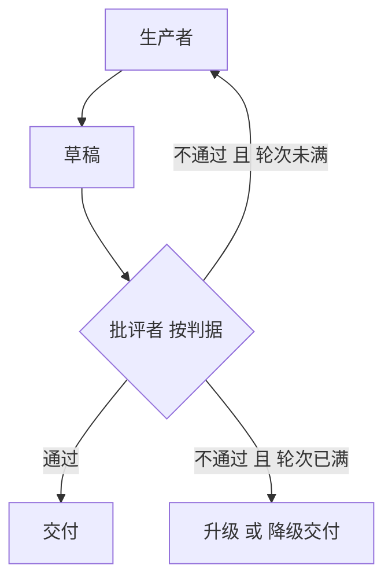

# 反思回路

- **难度**：★★☆ | **涉及章节**：第 4、7、17、19 章

## 一句话定义

反思是**带一条回边的控制结构**：产出 → 按判据检查 → 有问题就带着具体意见重做 → 直到判据通过或达到轮次上限。

## 为什么重要

没有回边的"多写一遍"不是反思。回边上必须挂两样东西：判据（怎么知道有问题）和出口（什么时候停）。缺出口，系统会无限循环或过度修改。

## 图示

## 详解

两种反思形态：
- **检查你的工作**：修"我忘了什么"（漏字段、漏步骤）；
- **内部批评者**：修"我以为对但其实错"（事实错、逻辑跳步）。

出口必须写死两个条件：**判据通过** 或 **max_rounds 达到**（实践值 2~3 轮）。第三轮之后通常只是在改措辞。

**分工**：异常处理止血（让这次不炸），反思想清为什么流血（让下次不炸）。

## 常见误解

- 别以为反思能补知识缺失——实际上它只能改表达与推理组织，缺的事实得靠检索。
- 别以为轮次越多越好——实际超过 3 轮收益极低，且上下文被旧版本占满。

## 在书中出现的脉络

| 章节 | 语境 | 关键结论 |
|---|---|---|
| 第 4 章 | 反思 | 三条退化路径：过度修正、批评空转、上下文溢出 |
| 第 7 章 | 多智能体 | 批评-审查者把产出与判定分到两个上下文 |
| 第 17 章 | 推理 | 自我纠错作为推理环节 |
| 第 9 章 | 学习 | 反思结果可写成程序性记忆 |

## 相关概念

- 前置：外部判据
- 后续：多智能体协作、学习与适应
