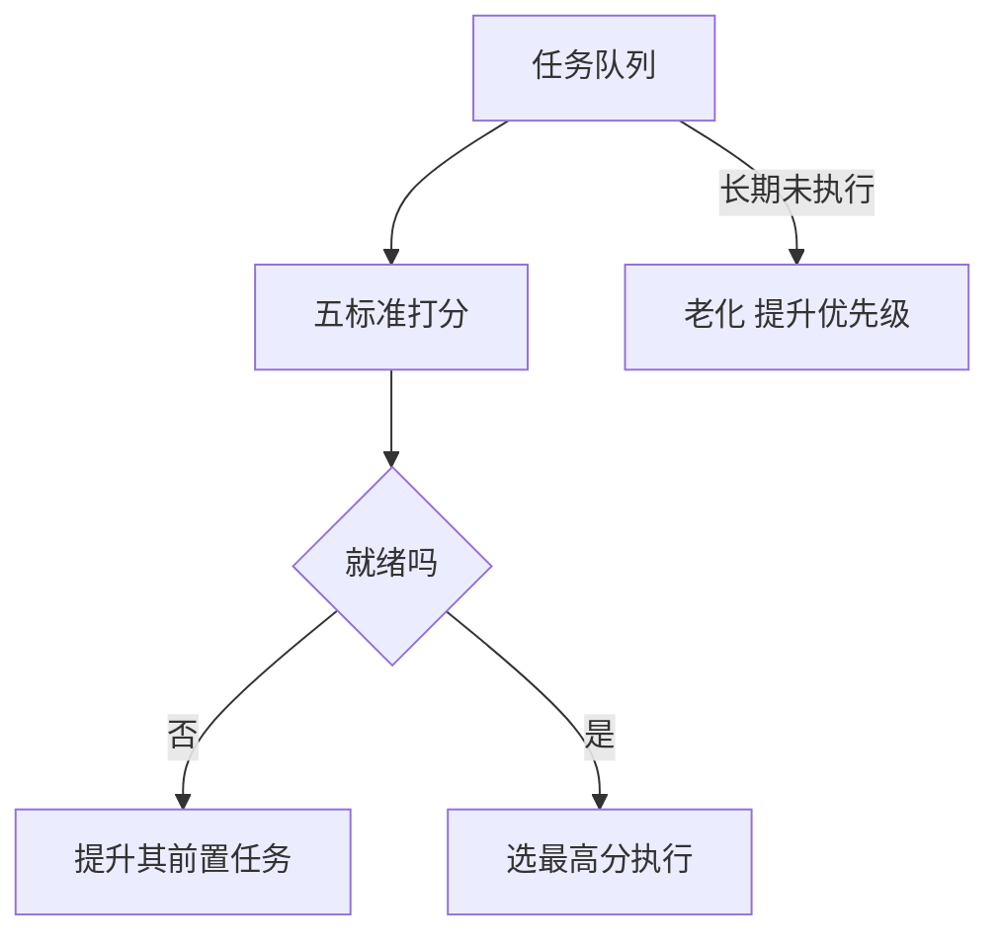

# 优先级排序即调度

- **难度**：★★☆ | **涉及章节**：第 20、16、6 章

## 一句话定义

优先级排序回答的不是"哪个任务最好",而是"资源有限时下一个动手的应该是哪一个"。它是调度问题，不是评价问题。

## 为什么重要

把调度当评价，会出现两个典型错误：给所有任务打一个"重要性分数"却忽略依赖与就绪状态；把"紧急"当成可随意插队的通行证，导致低优先级任务永久饥饿。

## 图示

## 详解

五标准：紧急（距截止时间）、重要（对主目标影响）、依赖出度（多少任务等它）、资源就绪（能不能现在干）、成本收益。

三个故障与解法：
- 饥饿 → 老化（每等待一周期升一档）；
- 优先级通胀 → 配额（P0 最多占 20% 槽位）；
- 依赖反转 → 传递提升（把被阻塞任务的前置提上来）。

三层级：目标层、计划层、行动层用不同标准。

## 常见误解

- 别以为 LLM 能靠"ASAP"这类措辞判优先级——实际上要靠结构化字段与规则。
- 别以为排好序就完事——实际上依赖、资源、截止都在变，必须动态重排且有频率上限。

## 在书中出现的脉络

| 章节 | 语境 | 关键结论 |
|---|---|---|
| 第 20 章 | 优先级排序 | 静态 vs 动态；三个故障 |
| 第 16 章 | 资源优化 | 关键任务优先分配资源 |
| 第 6 章 | 规划 | 计划内的步骤顺序本质是调度 |

## 相关概念

- 前置：规划
- 后续：资源感知优化
