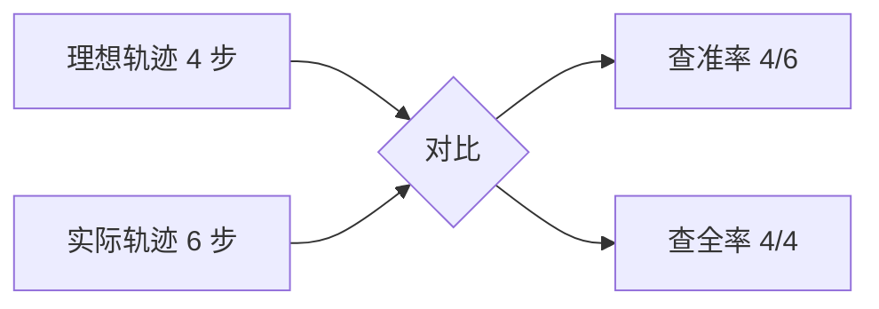

# 轨迹评估

- **难度**：★★★ | **涉及章节**：第 19、3、7 章

## 一句话定义

不只比较最终答案，还比较"它走了哪几步"：把实际步骤序列与理想路径对比，用精确匹配、顺序匹配、任意顺序匹配、查准率、查全率五种方式量化。

## 为什么重要

智能体是概率性的，结果对但过程违规（查了不该查的数据）、结果错但过程合理（信息源错）都很常见。只看结果，这两类问题都看不见。

## 图示

## 详解

五种方式各管一类问题：
- 精确匹配：严重偏离；
- 顺序匹配：跳步、乱序；
- 任意顺序匹配：遗漏；
- 查准率：多余动作；
- 查全率：漏关键环节。

**例子**：理想"识别意图 → 查订单 → 审核 → 回复";实际多了一次重复查订单、多了一次查用户资料。查全 100%,查准 66.7%。两个指标必须一起看。

**附带指标**：同一工具连续调用 3 次以上，通常意味着上次失败但模型没察觉。

## 常见误解

- 别以为轨迹评估要严格按理想路径——实际上应该定义"可接受路径集合",否则会误判合理变体。
- 别以为准确率高就没问题——实际上过程违规不会体现在准确率上。

## 在书中出现的脉络

| 章节 | 语境 | 关键结论 |
|---|---|---|
| 第 19 章 | 评估 | 传统测试只判通过/失败，不够 |
| 第 3 章 | 并行 | 并行分支的合并顺序影响可评估性 |
| 第 7 章 | 多智能体 | 还要评协作与分工是否正确 |

## 相关概念

- 前置：错误局部化
- 后续：漂移检测、A/B 测试
