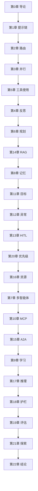

# 学习路径：从零到大二水平的智能体设计

面向大二数学/计科背景：假定你会线代、概率、基础 Python，跳过四则运算级铺垫，重点压在**模式的设计动机与失效条件**上。

## 路径总览

顺序不是书序，是按依赖拓扑排的。三处关键调整：**工具使用提到反思之前**（反思的判据常来自工具与测试结果）；**RAG 提到记忆之前**（向量检索是长期记忆的底层）；**治理组（目标/异常/HITL）放在协作之前**（先会兜底，再谈扩张）。

## 步骤 1：建立框架感
**目标**：能用五特征与四级自主度给一个产品定位。
**阅读**：第 0 章
**检查点**：第 0 章自测 ≥3/4
**复习**：抽认卡标签 `基础`

## 步骤 2：把任务拆成可验证的片段
**目标**：写出一个三步提示链，每步带输出契约。
**阅读**：第 1 章 + 概念页「输出契约」
**检查点**：能手画链条并标出每步的校验点
**复习**：卡片「提示链的价值是什么」

## 步骤 3：让系统自己选路
**目标**：为一个请求集合设计分层路由，含兜底分支，并算出成本差。
**阅读**：第 2 章
**检查点**：第 2 章自测 ≥3/4,能算「日 10 万请求、规则命中 62% 时的付费调用量」
**复习**：卡片「路由器必须有什么」

## 步骤 4：并发与冗余
**目标**：判断两个子任务能否并行，选出截面并行或投票并行。
**阅读**：第 3 章
**检查点**：能算出串行/并行耗时差
**复习**：卡片「投票并行压不住什么错误」

## 步骤 5：给模型一双手
**目标**：写一个工具有 schema、有负向说明、有失败处理。
**阅读**：第 5 章
**检查点**：能画出六步工具循环，指出框架是唯一执行者
**复习**：概念页「幂等」

## 步骤 6：让系统会自我检查
**目标**：设计一个带外部判据与轮次上限的反思回路。
**阅读**：第 4 章 + 概念页「反思回路」「外部判据」
**检查点**：能说出三条退化路径并各给一个防法
**复习**：卡片「反思什么时候无效」

## 步骤 7：从执行者到规划者
**目标**：为多步任务选清单式/DAG/迭代式计划，写清重规划触发条件。
**阅读**：第 6 章
**检查点**：第 6 章自测 ≥3/4
**复习**：卡片「三种计划形态怎么选」

## 步骤 8：把知识塞进上下文
**目标**：设计一个带阈值与混合检索的 RAG 流程，并说明误差来源。
**阅读**：第 14 章 + 概念页「嵌入与余弦相似度」
**检查点**：能手算余弦相似度；能说出分块/嵌入/检索/增强四环各自的坑
**复习**：卡片「为什么高维语义近等于夹角小」

## 步骤 9：跨会话记住事情
**目标**：区分 Session/State/Memory，写出三类长期记忆的写入与召回策略。
**阅读**：第 8 章 + 概念页「上下文窗口与记忆」
**检查点**：能算出压缩前后的 token 差
**复习**：卡片「直接改 session.state 会怎样」

## 步骤 10：让目标可判定
**目标**：把一个模糊目标改写成含指标、阈值、时限、判定者的目标。
**阅读**：第 11 章
**检查点**：能完成一次目标改写练习
**复习**：卡片「目标不可判定会怎样」

## 步骤 11：失败的兜底
**目标**：为一条链设计五策略异常处理，并确认幂等。
**阅读**：第 12 章 + 概念页「幂等」
**检查点**：能举出「看起来成功的失败」的例子
**复习**：卡片「重试的前提是什么」

## 步骤 12：划出人机边界
**目标**：列出四个审批节点并说明判据。
**阅读**：第 13 章 + 概念页「人类参与边界」
**检查点**：能算审核人力需求
**复习**：卡片「on-the-loop 适合什么」

## 步骤 13：资源有限时先做哪个
**目标**：用五标准给任务排序，识别饥饿/通胀/依赖反转。
**阅读**：第 20 章 + 概念页「优先级排序即调度」
**检查点**：能完成四任务排序算例
**复习**：卡片「就绪为什么是一票否决」

## 步骤 14：把质量当变量
**目标**：算清一次调用成本，设计分层路由，说明两个闭环。
**阅读**：第 16 章
**检查点**：能独立算出 0.042 元/次与节省 56% 的过程
**复习**：卡片「批判智能体怎么省钱」

## 步骤 15：拆成团队
**目标**：选一种拓扑与一种协作形式，指出单点故障。
**阅读**：第 7 章
**检查点**：能画出监督者 + 批评-审查者组合
**复习**：卡片「拆的三个理由」

## 步骤 16：接上外部能力
**目标**：判断该用函数调用还是 MCP，写出 FastMCP 最小服务器。
**阅读**：第 10 章
**检查点**：能算 N×M → N+M 的集成数
**复习**：卡片「MCP 救不了什么」

## 步骤 17：跨框架协作
**目标**：读懂 Agent Card，为三类任务时长选交互机制。
**阅读**：第 15 章
**检查点**：能说清 A2A 与 MCP 的分工
**复习**：卡片「A2A 的任务为什么有状态机」

## 步骤 18：让系统会变好
**目标**：区分六种学习方式，判断一个需求该走哪条路。
**阅读**：第 9 章
**检查点**：能说出 PPO 裁剪切的是什么、DPO 省掉了什么
**复习**：卡片「什么时候不该微调」

## 步骤 19：推理的技术谱系
**目标**：为四个任务分别选 CoT/ToT/ReAct/PALMs,并算出自洽投票成功率。
**阅读**：第 17 章
**检查点**：能算 1-(1-p)^n
**复习**：卡片「推理扩展的三个前提」

## 步骤 20：不出事
**目标**：设计三层护栏，指出各自的失败动作与绕过路径。
**阅读**：第 18 章 + 概念页「护栏分层」
**检查点**：能写出工具参数校验回调的逻辑
**复习**：卡片「工具层为什么最关键」

## 步骤 21：能证明它有用
**目标**：设计一次轨迹评估与一次 A/B 对比。
**阅读**：第 19 章 + 概念页「轨迹评估」
**检查点**：能算查准/查全，能解释 LLM 评审的两个偏见
**复习**：卡片「为什么传统测试不够」

## 步骤 22：去没地图的地方
**目标**：说出探索与优化的区别，描述生成-辩论-进化循环。
**阅读**：第 21 章
**检查点**：能指出三个前提（外部验证、竞争淘汰、人守方向）
**复习**：卡片「探索的产出率为什么低」

## 步骤 23：收束
**目标**：把 21 个模式归到四组能力，用一个案例串起五个模式。
**阅读**：第 22 章
**检查点**：能说出「该停止加模式」的三个信号
**复习**：卡片「评估为什么是公共依赖」

## 学完全程后

**你能**：
- 拿到一个需求，先定 Level（0~3），再选模式，而不是先选框架；
- 为每条链写出输出契约与校验点；
- 算清一次调用的成本与并行/串行的收益；
- 说出每个模式的失效条件，并给出兜底方案；
- 设计一套可验证的评估（轨迹 + 指标 + 趋势）。

**综合检验**：
设计一个「合同审查助手」：输入一份 PDF 合同，输出风险清单与修改建议。
要求：至少用到提示链、工具（PDF 解析）、RAG（法规库）、反思（外判据为条款原文）、护栏（不外发）、人类参与（高风险条款人工确认）、成本估算（单份成本与日处理量）。
评分要点：
1. 每个环节有明确输入输出与校验点；
2. 反思有外部判据而非自评；
3. 高风险操作有审批节点，判据是"能否撤回";
4. 给出单份成本与日成本估算，并说明分层路由策略；
5. 指出至少三处可能失效的条件。
